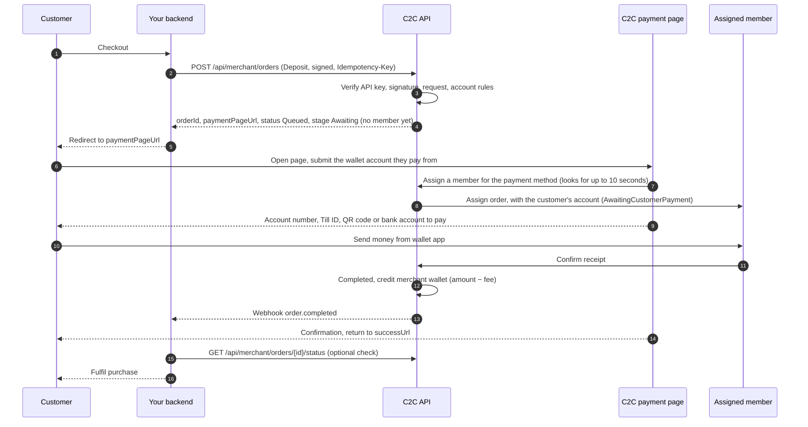
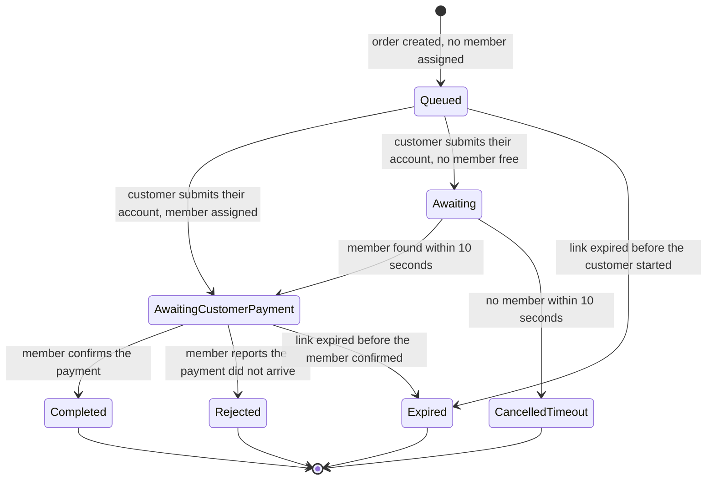

## Overview

A deposit collects money from your customer. On the hosted payment page the customer first gives the wallet account they will pay from. C2C then assigns a verified **member**, the customer pays that member from their own mobile wallet, the member confirms receipt, and C2C credits your merchant wallet with the amount minus fees.

The `walletType` you request is the [payment method](/guides/payment-methods): JazzCash or Easypaisa, by account number, Till ID or QR code, or a bank account, paid by bank transfer from a JazzCash or Easypaisa wallet. The customer is only ever given a receiving account of exactly that method.

<Warning>
  **Changed behaviour.** No member is assigned when the order is created any more. Every new deposit is answered with status `Queued` and stage `Awaiting`, and a member is assigned only when the customer submits the account they pay from. The customer no longer enters a transaction ID or IBAN digits and no longer confirms the payment on the page: the member confirms it when the money arrives, so new deposits go from `AwaitingCustomerPayment` straight to `Completed`.
</Warning>

## Flow diagram



## Step by step

### 1. Create the order

Your backend calls [Create Deposit Order](/api-reference/endpoints/create-deposit) with a signed request and an `Idempotency-Key`. Before creating anything, C2C checks:

1. **API key** valid and active, otherwise `401`
2. **Signature** (the body's `signature` field) valid, otherwise `401`. Deposits are always signature-enforced.
3. **Request** valid, otherwise `400`
4. **Merchant account** active and **IP whitelist** passed, otherwise `403`
5. **Payment method** (`walletType`) enabled for deposits on your account, otherwise `422`
6. **Amount** within the [limit of the payment method](/guides/payment-methods#amount-limits), otherwise `422` with the code `order.amountOutOfRange`
7. **`merchantOrderRef`** not already used by an order that is in progress or completed, otherwise `409`. See [`merchantOrderRef` rules](/guides/order-status#merchantorderref-rules).

The order is then **accepted** (`200`) with status `Queued` and stage `Awaiting`, and you get its `orderId`, `orderReference` and `paymentPageUrl`. **No member is assigned yet.** A member is assigned only when the customer submits the account they pay from (step 3), so a customer who opens the link and leaves never occupies a member.

Your merchant fee is fixed when the order is accepted. It's re-quoted only if the customer pays with a different method than you requested, and it's capped at the deposit amount, so the credit to your wallet is never negative. Later fee-rule changes apply to new orders only.

### 2. Redirect the customer

Send the customer to `paymentPageUrl` right away. The link is valid for **15 minutes**. See [Hosted payment page](/guides/hosted-payment-page).

### 3. Customer gives the account they pay from, and a member is assigned

The page opens on the method you requested. The customer enters the wallet account number they will pay **from**: their JazzCash account for a JazzCash method, their Easypaisa account for an Easypaisa method (11 digits starting with `03`, for example `03001234567`). On `BankAccount` they first choose which of the two wallets they pay from.

Once they submit it, C2C looks for an **eligible member**: online, with an approved receiving account of exactly the requested method, a limit covering the amount, and enough balance to back the deposit. No method falls back to another: `JazzCash` is never given a JazzCash Till ID or QR code, and never an Easypaisa account, and `BankAccount` is only ever given a bank account. See [Exact matching](/guides/payment-methods#exact-matching).

- **Member free:** the member is assigned within a moment and notified in their app. The order moves to `AwaitingCustomerPayment` (stage `Assigned`) and the page shows where to pay.
- **No member free:** the order moves to `Awaiting` and the page shows **Assigning Collection Account** with a 10-second countdown while C2C keeps looking. If a member becomes available in that time, the order continues as above.
- **Still nobody after 10 seconds:** the order fails with `CancelledTimeout`. The page shows **"Failed to assign the order to a member. Please check with support."**, and you receive an `order.failed` webhook with that text as its `reason`. The customer is never told why no member was available.

### 4. Customer pays

The customer sends exactly the order amount from the account they gave, using their own wallet app:

| Method | The customer enters first | The page then shows |
|--------|---------------------------|---------------------|
| `JazzCash` | Their JazzCash account number | The account number to pay, with a copy button |
| `JazzCashTillID` | Their JazzCash account number | The Till ID to pay, with a copy button |
| `JazzCashQR` | Their JazzCash account number | The QR code to scan or save |
| `Easypaisa` | Their Easypaisa account number | The account number to pay, with a copy button |
| `EasypaisaTillID` | Their Easypaisa account number | The Till ID to pay, with a copy button |
| `EasypaisaQR` | Their Easypaisa account number | The QR code to scan or save |
| `BankAccount` | The wallet they pay from (JazzCash or Easypaisa) and its account number | The bank name, account title and account number to pay, each with a copy button |

No transaction ID and no IBAN digits are asked for. After paying, the customer can tap **I have sent the payment**: the order then moves to `AwaitingMemberConfirmation` and the member is asked to check for the payment. Without it the order stays `AwaitingCustomerPayment` until the member acts. See [Hosted payment page](/guides/hosted-payment-page#what-your-customer-sees) for each screen.

### 5. Member confirms

The member sees the order in their app together with the account the customer gave, and watches for a payment of the order's amount from that account:

- **Payment arrived, member confirms** → `Completed`. Your wallet is credited **amount − fee**, and an `order.completed` webhook is sent. The page shows the confirmation and returns the customer to your `successUrl`.
- **Member reports that the payment did not arrive** → `Rejected`, and an `order.failed` webhook is sent.
- **Not confirmed before the link expires** (15 minutes after the order was created) → `Expired`, and an `order.failed` webhook is sent.

### 6. Fulfil

Fulfil the purchase only when the status is `Completed`. If you set `successUrl` / `failureUrl`, the payment page sends the customer back to you with the outcome appended; still confirm the status server-side before fulfilling. See [Returning the customer](/guides/hosted-payment-page#returning-the-customer-to-your-site).

## Status lifecycle



| Status | Stage | Meaning |
|--------|-------|---------|
| `Queued` | `Awaiting` | Created. The customer hasn't submitted the account they pay from, and no member is assigned. |
| `Awaiting` | `Awaiting` | The customer submitted their account and a member is being looked for. At most about 10 seconds. |
| `AwaitingCustomerPayment` | `Assigned` | A member is assigned and the page shows where to pay. Waiting for the payment to arrive and the member to confirm it. |
| `Completed` | `Completed` | The member confirmed the payment. Your wallet is credited. |
| `CancelledTimeout`, `Expired`, `Rejected` | `Failed` | Final without settlement. See the table below. |

A deposit normally goes straight from stage `Assigned` to `Completed`: the member's confirmation is the only step after the account is shown, so the `lifecycle` timestamps `sentAt`, `approvedAt` and `completedAt` share one timestamp, as for a withdrawal. See [Lifecycle stages](/guides/order-status#lifecycle-stages).

| Situation | Status | Webhook |
|-----------|--------|---------|
| Member confirms the payment | `Completed` | `order.completed` |
| Member reports that the payment did not arrive | `Rejected` | `order.failed` |
| No member could be assigned within 10 seconds of the customer submitting their account | `CancelledTimeout` | `order.failed` (`reason`: `Failed to assign the order to a member. Please check with support.`) |
| The link expired (15 minutes) before the customer submitted their account, or before the member confirmed a payment | `Expired` | `order.failed` (`reason`: `Checkout expired before payment`) |

<Note>
  An `Expired` order can belong to a customer who did pay, but whose payment wasn't confirmed before the link expired. An order that failed can later be confirmed by C2C operations; you then receive `order.completed` after the earlier `order.failed`. See [Webhooks](/guides/webhooks#events).
</Note>

<Note>
  `AwaitingMemberConfirmation` means the customer tapped **I have sent the payment** on the page and the member is verifying it. Such an order no longer expires with the checkout link; it moves to `ManualReview` if the member doesn't act in time.
</Note>

### Retrying after a failed assignment

A deposit that ended `CancelledTimeout` isn't retried automatically. To let the customer try again, create a **new** order with a new `Idempotency-Key`. You can reuse the same `merchantOrderRef`, because the earlier order failed. See [`merchantOrderRef` rules](/guides/order-status#merchantorderref-rules).

## Example: complete deposit integration

<CodeGroup>
```javascript Node.js
// 1. Create the order (signBody: see the Signature Generation Guide)
async function startDeposit(cart) {
  const payload = {
    orderType: 'Deposit',
    amount: cart.total,
    currency: 'PKR',
    walletType: 'JazzCash',
    merchantOrderRef: cart.id,
    customerReference: cart.customerId,
    callbackUrl: 'https://merchant.example.com/webhooks/c2c',
  };
  const res = await fetch(`${BASE_URL}/api/merchant/orders`, {
    method: 'POST',
    headers: {
      'C2C-API-Key': process.env.C2C_API_KEY,
      'Content-Type': 'application/json',
      'Idempotency-Key': `${cart.id}-deposit`,
    },
    body: JSON.stringify({ ...payload, signature: signBody(payload, process.env.C2C_SIGNING_SECRET) }),
  });
  if (!res.ok) throw new Error(`Create deposit failed: HTTP ${res.status} ${await res.text()}`);
  const { data } = await res.json();
  await db.carts.update(cart.id, { c2cOrderId: data.orderId, c2cStatus: data.status });
  return data.paymentPageUrl; // 2. redirect the customer here
}

// 4/5. On webhook or poll: fulfil only on Completed
async function onC2COrderUpdate(orderId) {
  const { status } = await getOrderStatus(orderId); // GET /api/merchant/orders/{id}/status
  const cart = await db.carts.findByC2COrderId(orderId);
  await db.carts.update(cart.id, { c2cStatus: status });
  if ((status === 'Completed' || status === 'Confirmed') && !cart.fulfilled) {
    await fulfil(cart);
  }
}
```

```python Python
import os, requests

# sign_body(): see the Signature Generation Guide
def start_deposit(cart) -> str:
    payload = {
        "orderType": "Deposit",
        "amount": cart.total,
        "currency": "PKR",
        "walletType": "JazzCash",
        "merchantOrderRef": cart.id,
        "customerReference": cart.customer_id,
        "callbackUrl": "https://merchant.example.com/webhooks/c2c",
    }
    res = requests.post(
        f"{BASE_URL}/api/merchant/orders",
        json={**payload, "signature": sign_body(payload, os.environ["C2C_SIGNING_SECRET"])},
        headers={
            "C2C-API-Key": os.environ["C2C_API_KEY"],
            "Idempotency-Key": f"{cart.id}-deposit",
        },
    )
    res.raise_for_status()
    data = res.json()["data"]
    db.save_c2c_order(cart.id, data["orderId"], data["status"])
    return data["paymentPageUrl"]  # redirect the customer here


def on_c2c_order_update(order_id: str) -> None:
    status = get_order_status(order_id)["status"]
    cart = db.cart_by_c2c_order(order_id)
    db.set_c2c_status(cart.id, status)
    if status in ("Completed", "Confirmed") and not cart.fulfilled:
        fulfil(cart)
```
</CodeGroup>

## Best practices

- **Store `orderId` and your `Idempotency-Key`** with your order before you redirect.
- **Use webhooks and reconcile:** every final outcome sends a webhook, but `ManualReview` doesn't until it's resolved, and deliveries can fail.
- **Don't fulfil early:** `Queued`, `Awaiting` and `AwaitingCustomerPayment` are all in-progress states.
- **Redirect straight away.** No member is held for the order until the customer submits their account, and the link is valid for 15 minutes only.
- **Don't read `Queued` as "member assigned".** A new deposit is `Queued` with stage `Awaiting` until the customer starts; a member is assigned from `AwaitingCustomerPayment` on.
- **Treat `ManualReview` as pending.** The customer may have paid, so don't ask them to pay again until C2C resolves it.
- **One live order per `merchantOrderRef`.** To let the customer try again after a failed order, for example one that ended `CancelledTimeout` because no member could be assigned, create a new order (new `Idempotency-Key`); you can reuse the same `merchantOrderRef`.
